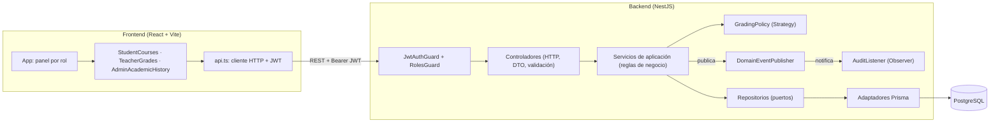

# UNICEN - Sistema académico

Monorepo con la API en NestJS ([backend/](backend/README.md)), la web en React ([frontend/](frontend/README.md)) y PostgreSQL vía Docker Compose.

## Ejecución con Docker Compose

### Requisitos

- [Docker Desktop](https://www.docker.com/products/docker-desktop/) (o Docker Engine) con Docker Compose v2.
- Puertos libres: `8080` (web), `3010` (API) y `5432` (PostgreSQL). Si alguno está ocupado, consulta [Configuración](#configuración-opcional).

### Pasos

1. Clona el repositorio y entra en la carpeta del proyecto:

   ```bash
   git clone <url-del-repositorio> unicen
   cd unicen
   ```

2. Construye las imágenes y levanta los tres servicios (base de datos, API y web):

   ```bash
   docker compose up --build
   ```

   No hace falta crear ningún archivo `.env`: todas las variables tienen valores por defecto para desarrollo local. Para ejecutarlo en segundo plano, agrega `-d` (`docker compose up --build -d`).

3. Espera a ver en los logs del servicio `api` estas líneas:

   ```text
   api-1  | All migrations have been successfully applied.
   api-1  | Seeding demo users and academic data...
   api-1  | Seeded accounts, 6 subjects, 7 course offerings, demo enrollments and grades.
   api-1  | Starting API on port 3010...
   ```

   La web se inicia cuando la API está lista.

4. Abre http://localhost:8080 e inicia sesión con una de las cuentas de prueba.

| Servicio | URL |
|---|---|
| Web (React servido por nginx) | http://localhost:8080 |
| API (NestJS) | http://localhost:3010 |
| PostgreSQL 17 | `localhost:5432` (usuario `unicen`, base `academic_system`) |

### Cuentas de prueba creadas automáticamente

No se crean a mano: cada vez que arranca el contenedor de la API, el script [backend/docker-entrypoint.sh](backend/docker-entrypoint.sh) ejecuta, en este orden:

1. `prisma migrate deploy`: crea o actualiza las tablas.
2. [backend/prisma/seed.mjs](backend/prisma/seed.mjs): crea las tres cuentas y los datos de ejemplo.
3. Inicia la API.

| Rol | Correo | Contraseña | Qué puede hacer |
|---|---|---|---|
| Administrador | `admin@unicen.edu.bo` | `AdminDemo123!` | Consultar el historial académico de todos los estudiantes con filtros por gestión, periodo, materia, curso o estudiante. |
| Docente | `docente@unicen.edu.bo` | `Docente123!` | Registrar, modificar y eliminar (borrado lógico) notas en Álgebra y Programación I. |
| Estudiante | `estudiante@unicen.edu.bo` | `Estudiante123!` | Inscribirse o cancelar cursos y consultar su historial académico. |

El seed es idempotente: si las cuentas ya existen, las actualiza sin duplicarlas, y las notas de ejemplo solo se cargan la primera vez para no sobrescribir los cambios de los docentes. Además de las cuentas, crea 6 materias, 7 ofertas de la gestión 2026, 2 inscripciones del estudiante y algunas notas de ejemplo.

Para comprobar las cuentas creadas en la base de datos:

```bash
docker compose exec postgres psql -U unicen -d academic_system -c 'SELECT email, role FROM "User" ORDER BY role;'
```

Estas credenciales son solo para evaluación local; cámbialas antes de cualquier despliegue real.

### Detener o reiniciar

```bash
docker compose down      # detiene los servicios y conserva los datos
docker compose down -v   # detiene los servicios y borra la base de datos
```

Después de `docker compose down -v`, el siguiente `docker compose up --build` vuelve a crear las tablas, las cuentas y los datos de ejemplo desde cero.

### Configuración (opcional)

Para cambiar algún valor, crea un archivo `.env` en la raíz del proyecto (junto a `docker-compose.yml`) con las variables a sobrescribir. Por ejemplo, si los puertos `8080` o `3010` están ocupados:

```dotenv
WEB_PORT=8081
API_PORT=3011
```

| Variable | Por defecto | Descripción |
|---|---|---|
| `WEB_PORT`, `API_PORT`, `POSTGRES_PORT` | `8080`, `3010`, `5432` | Puertos publicados en tu máquina. |
| `POSTGRES_USER`, `POSTGRES_PASSWORD`, `POSTGRES_DB` | `unicen`, `unicen_dev_password`, `academic_system` | Credenciales de la base de datos. |
| `JWT_SECRET` | secreto de desarrollo | Clave para firmar los tokens. |
| `ADMIN_*`, `DEMO_TEACHER_*`, `DEMO_STUDENT_*` | cuentas de la tabla anterior | Correo, contraseña y nombre de cada cuenta de prueba. |
| `SEED_DEMO_DATA` | `true` | Con `false`, solo se aplican las migraciones y no se crean cuentas ni datos de ejemplo. |
| `GRADING_POLICY`, `PASSING_SCORE` | `weighted`, `51` | Política de calificación (`weighted` o `average`) y nota mínima de aprobación. |

Si cambias `API_PORT`, ejecuta de nuevo `docker compose up --build`, porque la URL de la API se incluye en la web al compilarla. Si cambias las credenciales de PostgreSQL después del primer arranque, ejecuta `docker compose down -v`, porque la base de datos conserva las credenciales con las que se creó.

## Arquitectura



El backend sigue una **arquitectura por capas**: los controladores solo traducen HTTP (rutas, DTO validados, rol requerido); los servicios contienen las reglas de negocio; el acceso a datos queda detrás de repositorios. Cada módulo de Nest (`auth`, `students`, `subjects`, `course-offerings`, `enrollments`, `grades`, `audit`) agrupa sus capas y expone solo lo necesario.

## Patrones de diseño y justificación

| Patrón | Dónde | Por qué |
|---|---|---|
| **Repository** (puerto/adaptador) | `EnrollmentsRepository` y `GradesRepository` con sus adaptadores `Prisma*Repository` | Inscripciones y notas tienen las reglas más ricas (cupos, duplicados, ponderación, permisos del docente, borrado lógico). El servicio depende de una clase abstracta y no de Prisma, así las reglas se prueban con dobles en memoria (`grades.service.spec.ts`) y los detalles de persistencia, como la reserva atómica de cupo con un `UPDATE` condicional o el filtro `deletedAt: null`, quedan encapsulados en un solo lugar. Los módulos CRUD simples (materias, ofertas, estudiantes) usan Prisma directamente: un repositorio ahí solo duplicaría la API del ORM. |
| **Strategy** | `GradingPolicy` con `WeightedGradingPolicy` (puntaje acumulado por ponderación) y `AverageGradingPolicy` (promedio simple) | La forma de calcular la nota final y el estado aprobado/reprobado es una política académica que cambia entre carreras o reglamentos. El servicio solo llama a `summarize()`; agregar una política nueva no modifica el servicio (abierto/cerrado). |
| **Factory** | `createGradingPolicy()` registrado como factory provider de Nest | Construye la estrategia según la configuración (`GRADING_POLICY`, `PASSING_SCORE`) y valida los valores al arrancar, para que un error de configuración falle de inmediato y no al calcular notas. |
| **Observer** | `DomainEventPublisher` publica `enrollment.*` y `grade.*`; `AuditListener` se suscribe | Registrar, modificar o eliminar una nota requiere trazabilidad, pero la auditoría no es responsabilidad del servicio de notas. Los servicios publican eventos sin conocer a los suscriptores; nuevas reacciones (notificar al estudiante, persistir auditoría) se agregan como listeners sin tocar los servicios. |
| **Decorator** (de Nest) | `@CurrentUser()`, `@Roles()` | Extraen la identidad y la autorización de los controladores de forma declarativa y eliminan código repetido. |

Otras decisiones:

- **Borrado lógico de notas**: `DELETE /grades/:id` marca `deletedAt` y `deletedById`; las consultas solo devuelven notas activas. Una inscripción con notas (aun eliminadas) no puede cancelarse, porque la cascada borraría el historial.
- **Concurrencia en inscripciones**: el cupo se reserva con un `UPDATE ... WHERE enrolled < capacity` dentro de una transacción y la duplicidad se garantiza con un índice único, de modo que solicitudes simultáneas no superan la capacidad.
- **Frontend**: `App` elige el panel según el rol mediante un mapa `rol → componente`; cada panel gestiona sus datos y comparte el cliente `api.ts` (token, errores) y los componentes de presentación de notas.

## Desarrollo local sin contenedores

Consulta [backend/README.md](backend/README.md) (base de datos, migraciones, seed, API) y [frontend/README.md](frontend/README.md).
