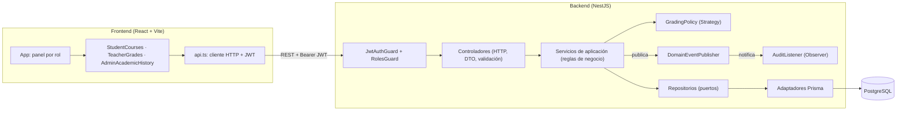

# UNICEN - Sistema académico

Monorepo con la API en NestJS ([backend/](backend/README.md)), la web en React ([frontend/](frontend/README.md)) y PostgreSQL vía Docker Compose.

## Arquitectura

El backend sigue una **arquitectura por capas**: los controladores solo traducen HTTP (rutas, DTO validados, rol requerido); los servicios contienen las reglas de negocio; el acceso a datos queda detrás de repositorios. Cada módulo de Nest (`auth`, `students`, `subjects`, `course-offerings`, `enrollments`, `grades`, `audit`) agrupa sus capas y expone solo lo necesario.

## Patrones de diseño y justificación

| Patrón | Dónde | Por qué |
|---|---|---|
| **Repository** (puerto/adaptador) | `EnrollmentsRepository` y `GradesRepository` con sus adaptadores `Prisma*Repository` | Inscripciones y notas tienen las reglas más ricas (cupos, duplicados, ponderación, permisos del docente, borrado lógico). El servicio depende de una clase abstracta y no de Prisma, así las reglas se prueban con dobles en memoria (`grades.service.spec.ts`) y los detalles de persistencia, como la reserva atómica de cupo con un `UPDATE` condicional o el filtro `deletedAt: null`, quedan encapsulados en un solo lugar. Los módulos CRUD simples (materias, ofertas, estudiantes) usan Prisma directamente: un repositorio ahí solo duplicaría la API del ORM. |
| **Strategy** | `GradingPolicy` con `WeightedGradingPolicy` (puntaje acumulado por ponderación) y `AverageGradingPolicy` (promedio simple) | La forma de calcular la nota final y el estado aprobado/reprobado es una política académica que cambia entre carreras o reglamentos. El servicio solo llama a `summarize()`; agregar una política nueva no modifica el servicio (abierto/cerrado). |
| **Factory** | `createGradingPolicy()` registrado como factory provider de Nest | Construye la estrategia según la configuración (`GRADING_POLICY`, `PASSING_SCORE`) y valida los valores al arrancar, para que un error de configuración falle de inmediato y no al calcular notas. |
| **Observer** | `DomainEventPublisher` publica `enrollment.*` y `grade.*`; `AuditListener` se suscribe | Registrar, modificar o eliminar una nota requiere trazabilidad, pero la auditoría no es responsabilidad del servicio de notas. Los servicios publican eventos sin conocer a los suscriptores; nuevas reacciones (notificar al estudiante, persistir auditoría) se agregan como listeners sin tocar los servicios. |
| **Decorator** (de Nest) | `@CurrentUser()`, `@Roles()` | Extraen la identidad y la autorización de los controladores de forma declarativa y eliminan código repetido. |

Otras decisiones:

- **Borrado lógico de notas**: `DELETE /grades/:id` marca `deletedAt` y `deletedById`; las consultas solo devuelven notas activas. Una inscripción con notas (aun eliminadas) no puede cancelarse, porque la cascada borraría el historial.
- **Concurrencia en inscripciones**: el cupo se reserva con un `UPDATE ... WHERE enrolled < capacity` dentro de una transacción y la duplicidad se garantiza con un índice único, de modo que solicitudes simultáneas no superan la capacidad.
- **Frontend**: `App` elige el panel según el rol mediante un mapa `rol → componente`; cada panel gestiona sus datos y comparte el cliente `api.ts` (token, errores) y los componentes de presentación de notas.

## Puesta en marcha

Consulta [backend/README.md](backend/README.md) (base de datos, migraciones, seed, API) y [frontend/README.md](frontend/README.md).
